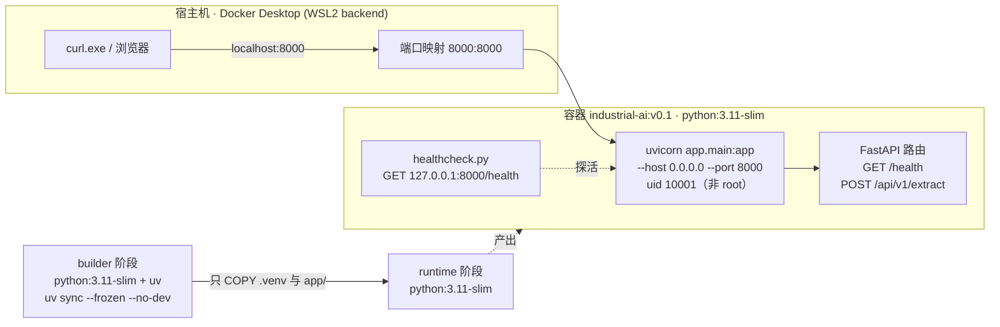

# industrial-ai-platform

Industrial AI platform backend, built with FastAPI and managed by [uv](https://docs.astral.sh/uv/).

## Requirements

- Python 3.11+
- [uv](https://docs.astral.sh/uv/getting-started/installation/)
- Docker Desktop（可选：只有跑容器时才需要，见 [Docker](#docker)）

From-scratch environment setup (Windows: uv, git, GitHub connectivity) is documented in
**[docs/SETUP.md](docs/SETUP.md)**.

The frozen HTTP contract for the extraction API lives in **[docs/api-spec.md](docs/api-spec.md)**.

## Setup

```powershell
uv sync
```

`uv sync` creates `.venv` and installs both runtime and dev dependencies.

## Run

```powershell
uv run uvicorn app.main:app --reload
```

Then open:

- Swagger UI: <http://127.0.0.1:8000/docs>
- Health check: <http://127.0.0.1:8000/health>

## Verify

```powershell
curl.exe http://127.0.0.1:8000/health
```

Expected output:

```json
{"status":"ok"}
```

Extraction endpoint:

```powershell
curl.exe -s -X POST http://127.0.0.1:8000/api/v1/extract `
  -H "Content-Type: application/json" `
  --data-binary "@body.json"     # {"text":"合同编号：HT-2026-001，甲方：张三","fields":["合同编号","甲方"]}
```

Expected output:

```json
{"request_id":"…","data":{"合同编号":"HT-2026-001","甲方":"张三"},"confidence":1.0,"elapsed_ms":101}
```

> Windows curl notes: use `curl.exe` (not `curl`), and pass JSON via `--data-binary "@file"` —
> PowerShell mangles inline JSON quotes. See `docs/SETUP.md` for details.

> On Windows PowerShell, `curl` is an alias for `Invoke-WebRequest`. Always use `curl.exe` to get real curl behaviour.

## Docker

多阶段构建 → 单容器跑 API → compose 起停 → 容器内探针。镜像里没有 uv、没有 tests、没有 `.git`，进程以 uid 10001 运行。

### 架构



```text
builder（装依赖，装完即弃）                        runtime（最终镜像）
python:3.11-slim                                   python:3.11-slim
  ├─ pip install uv                                  ├─ /app/.venv        ← 只拷产物
  ├─ COPY pyproject.toml uv.lock                     ├─ /app/app
  └─ uv sync --frozen --no-dev --no-install-project  ├─ /app/healthcheck.py
                                                     └─ USER 10001，CMD uvicorn（无 --reload）
```

### 快速开始

```powershell
cp .env.example .env          # 首次：运行时配置，.env 不入库、不进镜像
docker compose up --build -d  # 构建 + 后台启动
curl.exe http://localhost:8000/health
docker compose down
```

Expected: `{"status":"ok"}`

### 验收清单

| 检查项 | 命令 | 期望 |
| --- | --- | --- |
| 镜像体积 | `docker images industrial-ai:v0.1 --format "{{.Size}}"` | < 200 MB |
| 非 root | `docker compose exec api id -u` | `10001` |
| 健康探针 | `docker inspect --format "{{.State.Health.Status}}" industrial-ai-api` | `healthy` |
| 契约接口 | `curl.exe -s -X POST http://localhost:8000/api/v1/extract -H "Content-Type: application/json" --data-binary "@body.json"` | 200 + `data` |

### 排错

```powershell
docker compose logs -f api   # 跟日志（UNBUFFERED=1，stdout 直连）
docker compose ps            # 状态 / 健康 / 重启次数
docker compose down          # 停并删容器
```

- **容器内的 `127.0.0.1` ≠ 宿主机**：容器里 `127.0.0.1` 是容器自己的回环网卡，所以 uvicorn 必须 `--host 0.0.0.0`，否则宿主机 `localhost:8000` 连不上（但在容器内 `127.0.0.1:8000/health` 是通的）。健康检查故意打容器内 `127.0.0.1` —— 它要知道「容器里的进程活没活」，而不是「宿主机能不能连」。
- **故意写错一个环境变量**：把 `.env` 的 `PORT=8000` 改成 `PORT=abc` 再 `docker compose up -d`，容器会反复重启，`logs` 里是 `invalid literal for int()`（uvicorn 拿不到合法端口，启动即失败）。改回 `8000` 再 `up -d` 即恢复。
- **配置只在运行时注入**：`.env` 同时被 `.gitignore` 和 `.dockerignore` 排除，不会烤进镜像层。

### 已知状态

- 本机尚未安装 Docker Desktop / WSL2（2026-10-22 检查），因此 `docker build` 与 compose 验收**尚未在本机执行**；镜像体积与 uid 以验收命令实测为准。
- 依赖装法与启动路径已在虚拟环境中本地核对：`/health` → `{"status":"ok"}`、`/api/v1/extract` → 200、`docker/healthcheck.py` 退出码 0。

## Development

```powershell
uv run ruff check .        # lint
uv run ruff format .       # format
uv run pytest --cov=app    # tests + coverage
uv run pre-commit install  # enable git hooks (run once after git init)
```

## Contract stability

`POST /api/v1/extract` is **v1-frozen**. The rule-based extractor in
`app/services/extractor.py` is a placeholder: W2 swaps it for an LLM implementation behind the
same `async extract(text, fields)` signature, and `tests/test_api.py` must stay green **unchanged**.
That test file is the executable form of `docs/api-spec.md`.

## License

MIT
