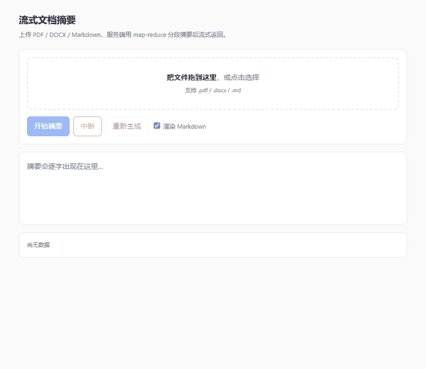

# industrial-ai-platform

**一个用 FastAPI + LLM 做文档智能处理的平台：结构化抽取、流式对话、超长文档摘要。**

重点不在"调通几个接口"，而在两条能拿证据说话的工程判断：

- **接口不变、实现可换**：同一份 `v1` HTTP 契约，底下从正则换成真实模型调用
  （再换成 JSON Schema 强约束 + 校验回灌），`tests/test_api.py` **一行未改**。
- **测试能离线跑绿**：**285 个测试，拔掉网线也全绿** —— 这才是"实现真的可替换"无法伪造的证据。

| 项目 | 值 |
| --- | --- |
| 端点 | `extract` · `extract/stream` · `chat/stream` · `summarize/stream` |
| 核心契约 | `POST /api/v1/extract`，`v1.1`（冻结；新增可选字段 `degraded`） |
| 测试 | **285 个，全离线**（拔网线也全绿），`pytest --cov=app` |
| 镜像 | 多阶段构建；v0.2.0 **待实测**（v0.1.0 曾为 157 MB，见 [Docker](#docker)） |
| 运行时 | Python 3.11 + uvicorn，非 root（uid 10001） |

---

## 这个项目解决什么

把一段非结构化文本（合同、工单、简历）按调用方指定的字段抽成结构化数据：

```http
POST /api/v1/extract
{"text": "合同编号：HT-2026-001，甲方：张三，签订日期：2026-10-20", "fields": ["合同编号", "甲方"]}
```

```json
{"request_id": "…", "data": {"合同编号": "HT-2026-001", "甲方": "张三"}, "confidence": 1.0, "elapsed_ms": 101}
```

三个设计取向值得先说清楚：

1. **抽不到就是 `null`，永不编造。** 不猜、不补全。这条不只写在 prompt 里，
   `LlmExtractor._ground_value` 会做**原文回指校验**：模型给出的值必须在正文里能找到依据，
   否则丢弃为 `null`。prompt 拦不住幻觉，代码能。
2. **所有非 2xx 是同一个 4 字段形状**（`code` / `message` / `request_id` / `details`）。
   调用方写一次错误处理就能覆盖 400/422/500。
3. **实现可换，契约冻死。** `docs/api-spec.md` 是唯一不能动的东西，
   规则版 → LLM 版是一次真实演进，不是重写。

---

## 架构

```
                       ┌──────────────────────────────────────────────┐
  浏览器 / CLI  ──────▶│  app/api/v1/            路由层（4 个端点）      │
                       │    extract.py     结构化抽取（v1 契约，冻结）   │
                       │    stream.py      抽取流式（SSE，event: end）  │
                       │    chat.py        聊天流式（SSE，[DONE]）      │
                       │    summarize.py   文档摘要流式（上传 + SSE）    │
                       └───────────────┬──────────────────────────────┘
                                       │  ExtractorDep / get_llm_client
                       ┌───────────────▼──────────────────────────────┐
                       │  app/core/                  装配与横切         │
                       │    deps.py     Extractor Protocol + 回退开关  │
                       │    config.py   LLMSettings + SecretStr        │
                       │    logging.py  装配 handler（否则 info 丢失）  │
                       │    sse.py      DisconnectWatcher（断开即停）   │
                       └───────────────┬──────────────────────────────┘
                                       │
      ┌────────────────────────────────┼────────────────────────────────┐
      │  W2 换实现的三层约束            │                                │
      │  ① prompt   让模型「倾向」对    │                                │
      │  ② JSON Schema 强约束结构       │                                │
      │  ③ Pydantic 本地校验语义        │                                │
      └────────────────────────────────┼────────────────────────────────┘
                                       │
                       ┌───────────────▼──────────────────────────────┐
                       │  app/services/               抽取的两套实现    │
                       │    llm_extractor.py  LlmExtractor   ◀ 默认    │
                       │      ├─ CorrectionsLoop  校验失败回灌（≤2 轮） │
                       │      ├─ _coerce_scalar  数字→字符串（本地修）  │
                       │      └─ degraded=True   用尽后标降级          │
                       │    extractor.py      RuleExtractor  ◀ 兜底    │
                       │      └─ extract_rule_based() 降级入口         │
                       │                                              │
                       │    rag/loaders/   PDF / DOCX / Markdown      │
                       │    rag/summarize.py  map-reduce 超长文档       │
                       └───────────────┬──────────────────────────────┘
                       ┌───────────────▼──────────────────────────────┐
                       │  app/core/llm/              模型接入层        │
                       │    client.py    get_llm_client() 进程级单例   │
                       │    streaming.py stream_chat + TTFT 口径      │
                       │    retry.py     指数退避+抖动 / 多 key 熔断   │
                       │    tools.py     Function Calling 注册表      │
                       │    tool_loop.py 单/多轮闭环                  │
                       └──────────────────────────────────────────────┘
```

跨层规则：**服务层与 rag 层都不 import fastapi**。依赖注入是路由层的事，
`LlmExtractor` 只接受一个 `AsyncOpenAI` 实例（构造参数注入，内部**绝不 new**），
所以测试里能直接塞 `FakeLLMClient` —— 这也是 **285 个测试全部能离线跑**的原因。

### 目录

```
app/
├── api/v1/          extract.py · stream.py · chat.py · summarize.py
├── core/            config.py · deps.py · errors.py · middleware.py · logging.py · sse.py
│   └── llm/         client.py · streaming.py · retry.py · tools.py · tool_loop.py
├── rag/             Document / LoadResult 统一模型
│   ├── loaders/     pdf.py · docx.py · markdown.py（加格式只改 __init__.py 一处）
│   ├── summarize.py map-reduce + 流式
│   └── replay.py    DEMO_REPLAY：录屏/联调用的同构回放
├── services/        extractor.py（规则+extract_rule_based）· llm_extractor.py（LLM+校验回灌）
├── schemas/         extract.py（含可选 degraded）· chat.py
└── cli/             summarize.py
scripts/             smoke_llm · demo_tools · consume_sse · cost · cost_model
                     latency_breakdown · record_demo · measure_tokens · drill_*
static/index.html    前端单页（fetch + ReadableStream，含中断/重试）
tests/               285 个**全离线**测试
  ├── fake_llm.py    FakeLLMClient（可复用，支持固定回复/脚本/异常/流式）
  ├── conftest.py    autouse: 默认注入离线规则版（拔网线也全绿）
  └── fixtures/      make_fixtures.py 脚本生成样本（review 可读）
docs/                api-spec.md（冻结契约 v1.1）· cost.md · sse.md · SETUP.md
```

---

## 快速开始

```powershell
uv sync                                   # 创建 .venv 并装依赖
Copy-Item .env.example .env               # 然后填 LLM_API_KEY / LLM_BASE_URL / LLM_MODEL
uv run uvicorn app.main:app --reload      # http://127.0.0.1:8000/docs
```

`.env` 里 5 个必需变量：

| 变量 | 说明 |
| --- | --- |
| `LLM_API_KEY` | 必填；空字符串会被启动校验拦下（比留空跑到 401 好） |
| `LLM_BASE_URL` | OpenAI 兼容端点，含 `/v1`；换供应商只改这一行 |
| `LLM_MODEL` | 模型名（**必须支持 `role=tool` 消息**，见下文「踩过的坑」） |
| `LLM_TIMEOUT` | 单次 HTTP 往返超时（秒） |
| `LLM_MAX_RETRIES` | SDK 内部重试，`0–5`；整体最坏耗时 ≈ `timeout × (1+max_retries)` |

验证：

```powershell
curl.exe http://127.0.0.1:8000/health
# {"status":"ok"}

curl.exe -s -X POST http://127.0.0.1:8000/api/v1/extract `
  -H "Content-Type: application/json" `
  --data-binary "@body.json"
```

> Windows 上必须用 `curl.exe`（PowerShell 的 `curl` 是 `Invoke-WebRequest` 别名），
> 且 JSON 用 `--data-binary "@file"` 传，行内引号会被 PowerShell 吃掉。

---

## LLM 接入：三个可验证的结论

这一块不是"能调通"，而是每条都有实测数据支撑。完整记录在
[`learn/llm/`](../learn/llm/)。

### 1. `temperature=0` 不等于「每次都一样」

同一 prompt、`temp=0` 跑 5 次，出了 **3 种**不同输出（差异只落在末句一个词上）。
`seed` 在本机网关上实测**不可复现**：`temp=0 + seed=42` 五次仍出 3 种，
且换 `seed` 有时完全相同、有时不同。

**所以确定性要自己实现**（缓存 / 校验 / 一致性投票），不能指望参数。
对我们的直接影响：**测试里不能断言"模型输出了某个具体字符串"**，
只能断言"字段合法、契约成立"。

### 2. `finish_reason` 才是截断的唯一判据

`max_tokens` 设小时，内容可能停在句号之后、肉眼看像完整句子，但
`finish_reason == "length"` 说明它是被硬砍的。只看长度会误判。

顺带一个坑：推理模型默认开启时，思维链会吃光 `max_tokens`，`content` 返回 `null`。
接入层必须把 `content is None` **当失败**处理，不能 `or ""` 静默成空串 ——
空串会被下游当成"模型说没有"，那是语义错误。

### 3. Function Calling 不是模型执行函数

模型只输出 `tool_calls`（工具名 + 参数 JSON），**执行 100% 在我们这侧**。
`TOOL_REGISTRY[name](**args)` 是我们自己的 Python 在跑。

这个边界决定了一切安全设计：模型会幻觉出不存在的工具名（实测 `send_email`），
会给出类型错的参数，所以 `execute_tool` 的铁律是**任何输入都不抛异常**，
失败也返回结构化数据回灌，让模型下一轮自愈。

工具层还包含：`get_weather`（假数据）、`calculate`（四则运算），
以及并行 `tool_calls` 的按 id 配对回灌、3 轮上限（防无限计费）。

### 成本

基于**真实 usage** 测算（脚本 `scripts/cost_report.py`，单价可配置）：

| 样本 | tokens/次 | 每 1000 次（示例单价） |
| --- | --- | --- |
| 短文本（22 字 / 2 字段） | 198 | 0.56 元 |
| 标准合同（109 字 / 4 字段） | 316 | 1.17 元 |
| 长合同（2,636 字 / 6 字段） | 1,996 | 4.46 元 |

> 单价取"输入 2 元 / 输出 8 元每百万 token"作为示例锚点，**不是任何供应商报价**。
> 关键结论是成本结构：**输出单价通常是输入的 3–5 倍**，
> 所以「少让模型说话」比「少喂正文」更省。
>
> **完整成本模型（含重试期望成本、优化敏感性）见 [docs/cost.md](docs/cost.md)。**
> 一句话结论：回灌重试不是"多一点时间"，是**多 3.5 倍钱**。

---

## 测试能离线跑绿 —— W2 唯一无法伪造的成果

```powershell
pytest -q          # 285 passed，拔掉网线也一样
```

这 行命令为什么值得单独一节：**它能证明实现真的可替换**。
如果测试依赖真实模型，那它测的就不是你的代码，而是供应商的可用性。
W4 加检索、W9 加工具、W12 加缓存，都不会破坏已有契约 —— 因为契约被**离线**测试锁住了。

### 这不是"顺便做到"，是踩出来的

**2026-10-27 的实测事故**：网关凭据过期返回 `502 未配置凭据`，
`LlmExtractor` 于是降级到规则版，响应体多出 `degraded` 键 ——
**契约测试 `test_api.py` 直接挂了**，而那个测试本身一行都没改、也没写错。

那一刻暴露了真问题：**任何依赖外部服务的测试都是定时炸弹**。

### 三层离线策略

| 层 | 手段 | 覆盖什么 |
| --- | --- | --- |
| **单测** | `tests/fake_llm.py` 的 `FakeLLMClient` | 校验回灌、降级、键序、编造拦截 |
| **HTTP 层** | `httpx2.MockTransport` 注入 | SDK 请求构造、`response_format` 是否真的发出 |
| **API 层** | `conftest.py` 的 `autouse` fixture | 默认注入规则版，`test_api.py` 一行不改仍全绿 |

### 为什么 HTTP 层不用 respx（实测做不到）

任务要求"集成测试用 respx 拦截 HTTP"。**实测失败**：

```
httpx  : 0.28.1
httpx2 : 2.16.0
httpx is httpx2 -> False      ← openai 3.37 用的是 httpx2（独立分叉）
respx 只 patch httpx          → 请求真实发到了网络
```

改用 SDK 官方支持的 `http_client=` 注入 `httpx2.MockTransport` ——
在**传输层**拦截，比 respx 的库级 monkey patch 更底层也更稳。
这个事实写成了测试（`test_respx_cannot_intercept_this_sdk`），
将来 SDK 若换回 `httpx`，那条测试会红，提醒我们可以简化。

### `FakeLLMClient` 的契约

它不是 mock，是 **stub** —— 不验证"你调了几次哪个参数"，
而是"给定这个输入，按剧本返回这个输出"。这样测试断的是**业务行为**，不是实现细节。

```python
# 固定回复
FakeLLMClient(replies=['{"甲方": "张三"}'])

# 脚本：第一轮坏、第二轮好（测回灌）
FakeLLMClient(replies=['{"甲方": {"nested": 1}}', '{"甲方": "张三"}'])

# 直接抛异常（测降级）
FakeLLMClient(exc=TimeoutError("boom"))

# 流式（测 SSE / streaming）
FakeLLMClient(stream_text="杭州很美")
```

---

## 换实现：三层约束 + 校验回灌 + 降级标记

### 三层约束，从"软"到"硬"

| 层 | 手段 | 拦的是什么 |
| --- | --- | --- |
| ① prompt | 明确要求只输出 JSON 对象 | 让模型**倾向**正确（不可靠） |
| ② JSON Schema | `response_format={"type":"json_schema", strict: true}` | 结构坏（漏键、多键） |
| ③ Pydantic | 本地校验 `{field: value}` | Schema 也漏掉的语义问题 |

**三层都要**：`response_format` 并非所有网关都真正支持（本机网关接受参数但未必强制），
只靠 prompt 时坏 JSON 相当常见。强约束被网关拒绝时，代码会自动关掉它再试一次 ——
**强约束是优化项，不是前提**。

### 校验失败 → 回灌重试（最多 2 轮）

模型给了不合规输出时，把 **Pydantic 的错误原样喂回去**：

```
你上一次的输出不符合要求，问题如下：
- 字段 合同编号：Input should be a valid string（你给的是 {'nested': 1}）

请只重新输出一个合法的 JSON 对象：键必须与我列出的字段完全一致……
```

比"重试同一个 prompt 碰运气"有效得多，因为错误信息直接告诉了它**哪里不对、错在哪个字段、收到了什么值**。

**为什么是 2 轮**：每轮都是一次真实计费调用 + 秒级延迟。实测坏输出大多第一轮就修好，
第三轮之后收益急剧下降，而用户已经等了 6 秒以上 —— 那时"给个规则版结果 + 标降级"更有价值。

### 一个关键的本地修复：标量归一

**"值的类型不合契约" 和 "值的内容不对"是两回事。**

| 情况 | 处理 | 为什么 |
| --- | --- | --- |
| 模型给 `128000`（数字）而不是 `"128000"` | **本地转字符串** | 常见、确定性可修、零成本 |
| 模型给 `{"nested": 1}`（嵌套对象） | 回灌让模型改 | 真的结构理解错误 |
| 模型给了正文里没有的值 | 丢弃为 `null` | 编造，不许放过 |

把能自己修的推给模型去修，是白花钱 —— 一次回灌要 160 额外输入 token（约 1.2 倍成本）。

### 降级：`degraded: true`

两轮仍失败 / 网络故障 → 规则版兜底并标记（`docs/api-spec.md §2.5`）：

```json
{
  "request_id": "…",
  "data": {"合同编号": "HT-2026-001", "甲方": null},
  "confidence": 0.375,
  "elapsed_ms": 102,
  "degraded": true
}
```

**只在 `true` 时出现这个键** —— 正常结果仍是 4 字段，老客户端零影响。
同时 `X-Extract-Model` 带 `+fallback(原因)` 后缀：头里是**原因**，body 里是**布尔事实**。

实测验证（网关凭据过期时）：

```
body  : {..., "degraded": true}
header: x-extract-model: buddy/glm-5.3+fallback(RetryExhaustedError)
```

换用可用模型后：4 字段、无 `degraded`、header 干净 `trae/qwen-3.5`。

---

## 契约冻住了吗？—— 这是最硬的证据

项目里最重要的一条测试在 `tests/test_api.py`：

```python
def test_service_is_swappable_without_touching_the_route(...):
    """换掉抽取实现，路由与响应形状完全不变。"""
```

W2 做完之后：

| 断言 | 状态 |
| --- | --- |
| `tests/test_api.py` 一行未改 | ✅ |
| 全套 285 个测试仍全绿（**断网也是**） | ✅ 285 passed |
| 响应体正常时仍是 4 字段 | ✅ 实测无 `degraded` 键 |
| 降级时可多 1 个可选字段 | ✅ `degraded: true`，v1.1 向后兼容 |
| 规则版仍可用 | ✅ `EXTRACTOR_IMPL=rule` 一键回退 |

---

## 流式文档摘要（本周主交付）

上传 PDF / DOCX / Markdown → 服务端 map-reduce 分段摘要 → SSE 逐字返回。
前端在 `static/index.html`（打开 `/ui`）。



> 15 秒演示（600px / 36 帧 / 646 KB）：选择 50 页 PDF → 进度条推进 → 摘要逐字出现
> → **点中断后立即停止**。截图见 [`docs/demo/ui_screenshot.png`](docs/demo/ui_screenshot.png)。

```powershell
uv run uvicorn app.main:app --port 8000
# 浏览器打开 http://127.0.0.1:8000/ui

# 或走 CLI
uv run python -m app.cli.summarize tests/fixtures/sample50.pdf --stream

# 重录演示（不需要 API key，也不花钱）
$env:DEMO_REPLAY="1"; uv run uvicorn app.main:app --port 8020
uv run python -X utf8 scripts/record_demo.py --port 8020
```

### 演示为什么是脚本录的，而不是人工录屏

`scripts/record_demo.py` 用 **Playwright 驱动系统 Chrome 逐帧截图 + Pillow 合成 GIF**，
不是 ScreenToGif 那类 GUI 录屏工具。三个理由：

1. **可复现**：别人想重录一遍，跑同一条命令即可，不用对着屏幕重新框选区域
2. **无需人工**：不需要有人守着点录制/停止
3. **画面稳定**：固定 viewport，没有通知弹窗、鼠标乱入、窗口遮挡

配合 `DEMO_REPLAY=1`（`app/rag/replay.py`），服务端走预置节奏而**前端代码路径完全真实**
（仍是 `fetch` + `ReadableStream` 解帧）。所以演示确定、快、不花 API 费用。

> 录 demo 时踩到一个坑：Playwright 的**同步 API 不能跨线程**。
> 第一版用后台线程持续截图，一帧都没抓到（异常被 try/except 吞了）。
> 改成 asyncio + 异步 API 才解决 —— 截图任务和页面动作在同一个事件循环里。

### 做了什么

| 层 | 内容 |
| --- | --- |
| `rag/loaders/` | pypdf 逐页抽（页码从 1 开始）· python-docx 抽段落**和表格** · Markdown 按标题切块 |
| 统一模型 | `{source, page, text}`，非分页格式 `page=None`（诚实，不假装有页） |
| `rag/summarize.py` | map-reduce：分段摘要 → 汇总；段数 > 10 走层级汇总 |
| `rag/replay.py` | 演示回放：同构事件序列，供录屏与无 key 联调 |
| `api/v1/summarize.py` | multipart 上传 + SSE（进度与正文同流） |
| `static/index.html` | fetch + ReadableStream 手工解帧（**EventSource 不能 POST**） |
| `CORS` | 放开 `*` 但不开 credentials（规范不允许 `*` + credentials 组合） |

### 首 token 慢，是模型慢还是链路慢？—— 打点回答

用 `scripts/latency_breakdown.py` 在每一层打点（5 次取 p50）：

| 层 | TTFT p50 | 相对上一层的开销 |
| --- | ---: | --- |
| ① 上游直连（裸 httpx，绕过一切我方代码） | **1301 ms** | — 这是**模型+网络的真实下限** |
| ② 经 SDK 封装（+重试层+StreamStats） | 1341 ms | **+40 ms** |
| ③ 端到端（FastAPI + HTTP + SSE 编码） | 1463 ms | **+122 ms** |

**结论：单次请求慢在模型，我方链路只占 162 ms（约 12%），可忽略。**
这个数字就是优化的靶子 —— 想压到 1.5s 以内，换更快的模型或更短的 prompt 才有意义，
优化 FastAPI 是白费力气。

**但长文档的"首字慢"是另一回事 —— 那是我方链路的问题：**

50 页 PDF 按 800 token 切 → 5–9 段 → **串行** map 调用。
用户要等 10899 ms 才看到第一个字，而单次调用只有约 2-3 秒。
**慢的不是模型，是我们串行调了 9 次。**

优化方向（按收益排序）：

1. **map 并发**（`summarize_streaming` 已实现，信号量限 4 路）—— 最大收益
2. **降低段数**：调大 `chunk_tokens`（段少 = 调用少 = 首字快，但单段更贵）
3. **把进度写进流**（已做）：前端能看到"正在总结第 3/9 段"，体感完全不同
4. 换更快的模型 —— 收益最低，因为单次本来就不慢

> 这个打点习惯是后续优化延迟的核心武器：**先分层测量，再动手**。
> 不分层的优化全凭猜测，而猜测通常是错的。

### 长文档压测（50 页 PDF）

| 指标 | 值 |
| --- | --- |
| 解析 + 切分 | 50 段 → 5 块（chunk_tokens=800） |
| 进度首帧 | +3592 ms（用户 3.6 秒就看到"正在总结"） |
| TTFT（首个摘要字） | **10899 ms** |
| 总耗时 | 13713 ms |
| 模型调用 | 6 次（5 map + 1 reduce） |

摘要质量：准确抓出"违约金自第 1 期 1‰ 逐期递增至第 50 期 50‰"这条规律，
并指出了"50 项条款结构完全一致"。

---

## 踩过的坑（都是实测，不是传闻）

| 坑 | 现象 | 结论 |
| --- | --- | --- |
| 某些模型不支持 tool 回灌 | 第二轮 502 `UNSUPPORTED_CONTENT` | 能返回 `tool_calls` **≠** 支持 Function Calling；能力是**双向**的 |
| `exc.body` 已被 SDK 剥壳 | `body["error"]["code"]` 恒为 `None` | 直接读 `body["code"]`，并兜底两种形态 |
| 推理模式吃光 `max_tokens` | `content=None`、`usage` 却正常 | 接入层必须把 `None` 当失败 |
| `request.is_disconnected()` 失效 | 生成器里恒为 `False`，客户端断了还在跑 | `StreamingResponse` 占用了 `receive` 通道；改监听 ASGI `http.disconnect` |
| **项目从未配置 logging** | 所有 `logger.info` 被静默丢弃 | root logger 未配置时 WARNING 以下蒸发；表现为"检测没生效"，实际是"日志没输出" |
| 测试数据每页内容相同 | 无法区分"正常去页眉"和"丢了正文" | 正文必须每页不同；否则测试通过与否都不说明问题 |
| `chunk_tokens` 有隐式下限 | 小预算被静默抬到 200 字/段 | "参数不生效"比报错更难查，下限要可推导 |
| Windows 控制台 GBK | 中文输出乱码/崩 | 脚本内 `reconfigure(encoding="utf-8")` + `-X utf8` |
| msys `sh` 读不懂 GBK 路径 | pre-commit hook 找不到 python | 重装 hook 时置 `PYTHONUTF8=1` |

> 最该记住的一条：**接入任何新模型，第一件事是跑一遍两轮闭环**，
> 而不是验"能不能返回 tool_calls"。后者的通过率远高于前者。

---

## Docker

三个阶段构建（builder → slim-base → scratch 拉入瘦身 rootfs）、非 root、
镜像内没有 uv / tests / `.git`。

```powershell
docker compose up -d --build
docker compose logs -f api
```

### 镜像大小：待重测（不要把旧数字当结论）

| 时间点 | 大小 | 状态 |
| --- | --- | --- |
| v0.1.0（纯 FastAPI，无 LLM/文档依赖） | **157 MB** | ✅ 当时实测 |
| v0.2.0（接入 LLM + 文档解析） | **待实测** | ⚠️ **当前无法构建，见下** |

**为什么不能沿用 157 MB**：v0.2.0 的运行时依赖新增了
`openai`(约 10 MB) + `lxml`(约 8.5 MB，python-docx 带) + `pypdf`(约 3.8 MB)
+ `tiktoken`(约 2.4 MB) + `python-docx`(约 2.3 MB) + `regex`(约 1.4 MB)
+ `markdown`(约 0.3 MB)，净增约 **28–30 MB**。
所以真实值大概在 **180 MB 上下** —— 但**这是估算，不是实测**，不能写进表格当结论。

> **这个数字要么实测、要么标明待测。** 实测命令：
> ```powershell
> docker build -t industrial-ai:sizecheck .
> docker image ls industrial-ai:sizecheck --format '{{.Size}}'
> ```
> CI 的 docker job 也会打出这个数（只记录不设阈值 ——
> 镜像大小随基础镜像更新波动，硬设阈值会变成"定期假失败"）。

**当前环境为何构建不了**：Docker Desktop 的代理设为 `127.0.0.1:7897`（manual 模式），
而该代理未运行；容器内无外网，`uv sync` 拉不到 `requests`/`pydantic-core` 等 wheel，
构建在 builder 阶段就失败。**这不是 Dockerfile 的问题** —— 代理起来后即可完成。

容器内的坑：

- **容器里的 `127.0.0.1` ≠ 宿主机**，所以 uvicorn 必须 `--host 0.0.0.0`；
  健康检查故意打容器内 `127.0.0.1` —— 它要判断"容器里的进程活没活"。
- 把 `.env` 的 `PORT=8000` 改成 `PORT=abc`，容器会进入 `Restarting` 循环，
  日志里是 `Invalid value for '--port'`。这个错误发生在**容器里**而不是 compose 解析期，是有意设计的。
- `.env` 同时被 `.gitignore` 和 `.dockerignore` 排除，不会烤进镜像层。

---

## 开发

```powershell
uv run ruff check .         # lint
uv run ruff format .        # format
uv run pytest --cov=app     # 95 tests + coverage
uv run pre-commit install   # 装 git hooks（clone 后跑一次）
```

CI 在 [`.github/workflows/ci.yml`](.github/workflows/ci.yml)：
Python 3.11 → `uv sync` → `ruff check` → `ruff format --check` → `pytest`。
**不需要真实 API key** —— 所有测试都用假 client 离线跑，这正是"服务层不依赖
fastapi、抽取器接受注入 client"的直接收益。

---

## 文档

- [docs/api-spec.md](docs/api-spec.md) —— **v1 契约**（现 v1.1，新增可选 `degraded`），唯一不能动的文件`n- [docs/cost.md](docs/cost.md) —— 成本模型：规则 vs LLM、回灌重试的真实代价、优化敏感性
- [docs/sse.md](docs/sse.md) —— SSE vs WebSocket vs 长轮询、双换行为什么是硬要求、
  裸 SSE 的 flush 时机、TTFT 口径、网关故障记录
- [docs/SETUP.md](docs/SETUP.md) —— 从零搭环境（Windows：uv / git / GitHub 连通性）
- `learn/llm/01_params.md` —— 采样参数实测（temperature / seed / max_tokens / stop）
- `learn/llm/02_function_calling.md` —— Function Calling 实测与网关踩坑

## License

MIT
