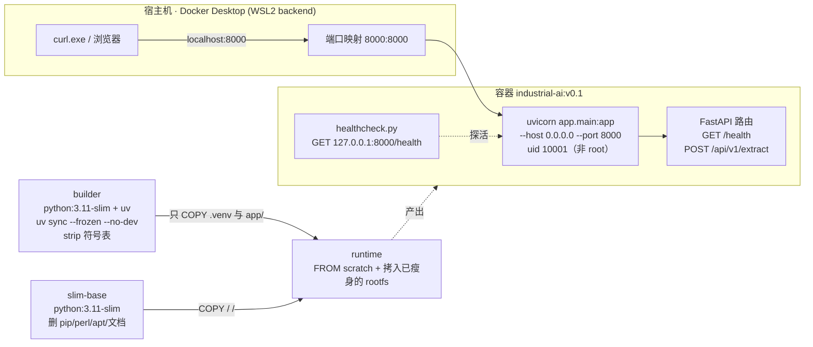

# industrial-ai-platform

Industrial AI platform backend, built with FastAPI and managed by [uv](https://docs.astral.sh/uv/).

## Requirements

- Python 3.11+
- [uv](https://docs.astral.sh/uv/getting-started/installation/)
- Docker Desktop（可选：只有跑容器时才需要，见 [Docker](#docker)）

From-scratch environment setup (Windows: uv, git, GitHub connectivity) is documented in
**[docs/SETUP.md](docs/SETUP.md)**.

The frozen HTTP contract for the extraction API lives in **[docs/api-spec.md](docs/api-spec.md)**.

## Setup

```powershell
uv sync
```

`uv sync` creates `.venv` and installs both runtime and dev dependencies.

## Run

```powershell
uv run uvicorn app.main:app --reload
```

Then open:

- Swagger UI: <http://127.0.0.1:8000/docs>
- Health check: <http://127.0.0.1:8000/health>

## Verify

```powershell
curl.exe http://127.0.0.1:8000/health
```

Expected output:

```json
{"status":"ok"}
```

Extraction endpoint:

```powershell
curl.exe -s -X POST http://127.0.0.1:8000/api/v1/extract `
  -H "Content-Type: application/json" `
  --data-binary "@body.json"     # {"text":"合同编号：HT-2026-001，甲方：张三","fields":["合同编号","甲方"]}
```

Expected output:

```json
{"request_id":"…","data":{"合同编号":"HT-2026-001","甲方":"张三"},"confidence":1.0,"elapsed_ms":101}
```

> Windows curl notes: use `curl.exe` (not `curl`), and pass JSON via `--data-binary "@file"` —
> PowerShell mangles inline JSON quotes. See `docs/SETUP.md` for details.

> On Windows PowerShell, `curl` is an alias for `Invoke-WebRequest`. Always use `curl.exe` to get real curl behaviour.

## Docker

三阶段构建 → 单容器跑 API → compose 起停 → 容器内探针。镜像里没有 uv、没有 tests、没有 `.git`，进程以 uid 10001 运行，**实测 157 MB**。

### 架构



```text
builder（装依赖 + strip，装完即弃）          slim-base（删掉运行时用不到的包）
python:3.11-slim                             python:3.11-slim
  ├─ pip install uv                            ├─ rm pip/setuptools/ensurepip
  ├─ uv sync --frozen --no-dev                 ├─ rm idlelib/distutils/tkinter/test
  └─ strip --strip-unneeded *.so               ├─ rm apt/perl 全家桶、docs/locale
                                               └─ useradd uid=10001
                    ↓ COPY（只拷产物）                    ↓ COPY / /（整个文件系统）
              runtime：FROM scratch
                ├─ /app/.venv         ← 剥过符号表的依赖
                ├─ /app/app           ← 源码
                ├─ /app/healthcheck.py
                └─ USER 10001，CMD uvicorn（无 --reload）
```

### 瘦身账本（实测）

| 阶段 | 体积 | 关键动作 |
| --- | --- | --- |
| 朴素双阶段 | **242 MB** | venv 43 MB（含 uvloop 12 MB 调试符号 + 编译好的 .pyc） |
| strip + 删基础镜像冗余包 | **211 MB** | 只降了 venv 的 27 MB；在 base 之上 `rm` **几乎没效果** |
| 重打包 rootfs（squash） | **157 MB** | 从 `scratch` 接住删干净的整个文件系统 |

> 为什么第二步「删了 20 MB 却一动不动」：镜像体积是**各层之和**。在 `python:3.11-slim` 之上再写一层 `RUN rm`，被删文件仍然躺在下面那层里，`docker images` 不会少一个字节。要真降下来，得把删干净的文件系统 `COPY` 成新的一层（本仓库的 `slim-base → scratch` 就是干这个）。
>
> 代价：单层镜像的增量拉取粒度变粗；容器里已经没有 apt/pip/perl，需要排查时请用宿主机的同名镜像或临时起一个带工具的调试容器。

### 快速开始

```powershell
cp .env.example .env          # 首次：运行时配置，.env 不入库、不进镜像
docker compose up --build -d  # 构建 + 后台启动
curl.exe http://localhost:8000/health
docker compose down
```

Expected: `{"status":"ok"}`

### 验收结果（2026-10-22 本机实测）

| 检查项 | 命令 | 实测 |
| --- | --- | --- |
| 镜像体积 | `docker images industrial-ai:v0.1 --format "{{.Size}}"` | `157MB`（< 200 MB ✅） |
| 非 root | `docker compose exec api id -u` | `10001` ✅ |
| 健康探针 | `docker inspect --format "{{.State.Health.Status}}" industrial-ai-api` | `healthy` ✅ |
| 契约接口 | `curl.exe -s -X POST http://localhost:8000/api/v1/extract ...` | `200` + `{"data":{"合同编号":"HT-2026-001","甲方":"张三"},...}` ✅ |

### 排错

```powershell
docker compose logs -f api   # 跟日志（UNBUFFERED=1，stdout 直连）
docker compose ps            # 状态 / 健康 / 重启次数
docker compose down          # 停并删容器
```

- **容器内的 `127.0.0.1` ≠ 宿主机**：容器里 `127.0.0.1` 是容器自己的回环网卡，所以 uvicorn 必须 `--host 0.0.0.0`，否则宿主机 `localhost:8000` 连不上；而容器内 `127.0.0.1:8000/health` 照样是通的。健康检查故意打容器内 `127.0.0.1` —— 它要知道「容器里的进程活没活」，而不是「宿主机能不能连」。
- **故意写错一个环境变量**：把 `.env` 的 `PORT=8000` 改成 `PORT=abc`，`docker compose up -d` 之后容器会进入 `Restarting` 循环（`restart: unless-stopped` 在拉它），日志里是：

  ```text
  Error: Invalid value for '--port': 'abc' is not a valid integer.
  ```

  改回 `8000` 再 `up -d` 即恢复。宿主机端口映射固定成 `8000:8000`，就是为了让这个错误发生在**容器里**，而不是变成 compose 的配置解析报错。
- **配置只在运行时注入**：`.env` 同时被 `.gitignore` 和 `.dockerignore` 排除，不会烤进镜像层。

### 环境记录

- 构建机：Windows 11 + Docker Desktop（WSL2 backend，client/server `29.9.2`），`python:3.11-slim` 基础镜像本身 **187 MB**（Debian trixie）。
- 本机位于受限网络，`registry-1.docker.io` / `auth.docker.io` 直连不通：拉不动镜像时给 Docker Desktop 配代理（Settings → Resources → Proxies → Manual，填本机 `127.0.0.1:7897`）再 `docker pull`。
- 初次部署需要 `cp .env.example .env`；`.env` 已被忽略，CI 里请用 secrets 注入。

## Development

```powershell
uv run ruff check .        # lint
uv run ruff format .       # format
uv run pytest --cov=app    # tests + coverage
uv run pre-commit install  # enable git hooks (run once after git init)
```

## Contract stability

`POST /api/v1/extract` is **v1-frozen**. The rule-based extractor in
`app/services/extractor.py` is a placeholder: W2 swaps it for an LLM implementation behind the
same `async extract(text, fields)` signature, and `tests/test_api.py` must stay green **unchanged**.
That test file is the executable form of `docs/api-spec.md`.

## License

MIT
