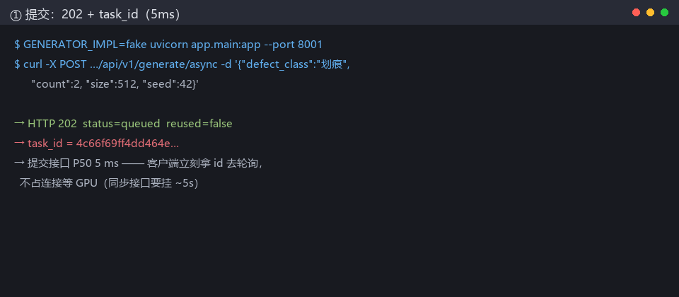

# 项目一：缺陷图像生成服务（SD + LoRA · FastAPI 异步封装）

**给缺陷检测数据集做数据增广的生成服务**：按缺陷类别（划痕/凹坑/气泡/裂纹/锈蚀/污渍）
生成 512²/768² 的工业缺陷图像，SD1.5 + 每类别一个 LoRA 适配器，
FastAPI 封装成同步 + 异步两个端点，**单 worker 串行消费**保护 GPU。



> 这是本仓库的**项目一**。项目二（文档知识库 RAG 平台）见[主 README](../README.md)。
> 两个项目共享一个仓库（同一套工程底座：统一错误体、request_id 贯穿、契约冻结纪律），
> 但**部署完全独立**——Dockerfile、compose、端口（8001 vs 8000）互不干扰。
> 完整技术报告：[report-project1.md](report-project1.md)；数字台账：[w14-number-ledger.md](w14-number-ledger.md)。

## 实测数字（每条带口径；两轮复现，区间表述）

| 指标 | 值 | 口径 |
| --- | --- | --- |
| 单张 512²（预热中位） | **约 5.0s**（两轮 4,867–5,002ms，漂移 2.8%） | RTX 4050 6GB / FP16 / steps=25 / attention_slicing / 含 VAE 解码 |
| 单张 512²（含冷启动） | 6,010 ms | 同上；8 次/轮 |
| 显存峰值 | **2.81 GB**（两轮逐位一致） | batch=1 · 512² |
| batch 吞吐 | batch=4 **0.158 反低于** batch=1 0.195 张/s | 6GB 卡上 batch 化不划算（反直觉结论） |
| 模型加载 | 2.67–3.45 s | 进程起 → pipeline 可用 |
| 异步提交 P50 | **4.2 ms**（202 + task_id） | fake 模式 30 次；同步阻塞是 ~5s，异步是接口占用 4ms——**架构收益，不是 GPU 加速** |
| 镜像 | 12.8 GB（**权重 0 字节进镜像**） | 其中 12.1GB 是 CUDA 12.8 运行时基座；`docker history` 逐层验证 |

复现：`SD_WEIGHTS_DIR=models/sd15 python -X utf8 scripts/benchmark_generator.py --size 512 --repeats 8`（真实 diffusers 推理）。

## 三层结构

### 模型层

| 项 | 值 | 说明 |
| --- | --- | --- |
| 基座 | SD 1.5（FP16） | 消费级显卡的原生分辨率，6GB 卡可跑 |
| 微调 | **LoRA（每类别一个适配器）** | **只训练低秩新增参数**——基座冻结。6 个类别 = 6 个 `.safetensors`，**换类别 = 换适配器文件，基座不动** |
| 权重 | volume 挂载（不进镜像） | `models/sd15/` 目录；换权重不用重 build 镜像 |

**"消费级显卡可跑"的口径**（如实）：
- 推理：RTX 4050 Laptop **6GB** 实测可载入 SD1.5 FP16（显存余量见
  [generator-benchmark.md](generator-benchmark.md) 的五数字表——**推理耗时的格子目前待真权重实测**，
  本 README 不引用未实测的数字）；
- **训练不在本服务范围内**：LoRA 适配器是离线训练的产物，本服务只负责**装配与推理**。

### 工程层

```
POST /api/v1/generate            同步：请求挂起直到出图（小批量场景）
POST /api/v1/generate/async      异步：202 + task_id 立刻返回（大批量场景）
GET  /api/v1/generate/tasks/{id} 查询：queued → running → succeeded / failed
```

| 设计 | 为什么 |
| --- | --- |
| **单 worker 串行** | GPU 是独占资源：多 worker 并发只会互相抢显存 → OOM，吞吐反降。"并发高"的正确位置在**入口**（5 个请求毫秒级各拿 task_id），推理侧排队 |
| **推理放 `asyncio.to_thread`** | SD 一跑 8~15 秒，不丢线程会冻结事件循环——连状态查询接口都会卡死 |
| **状态机表驱动** | `queued → running → succeeded/failed` 唯一迁移路径，非法迁移当场抛；没有 running→queued 的"重试"（重试=新任务） |
| **幂等复用** | 相同 `(defect_class, count, size, seed)` 且已成功 → 直接返回原 task_id，不重复占 GPU。`seed` 不传则视为"每次要新的"，不参与幂等 |
| **错误码与项目二同源** | `GPU_OOM`(503+Retry-After) / `GENERATION_TIMEOUT`(504) / `MODEL_NOT_LOADED`(503) / `UNKNOWN_DEFECT_CLASS`(422)——统一错误体 4 字段，一张错误码表 |
| **白名单类别** | 表外类别 422，**绝不静默用基座模型生成**（调用方以为在生成划痕，实际是噪声） |

契约与错误码表全文：[api-spec.md 项目一段](api-spec.md)。

### 部署层

```powershell
docker compose -f compose-gpu.yml up -d     # GPU 版（项目一）
docker compose up -d                        # CPU 版（项目二，另一个文件互不误起）
```

| 项 | 值 |
| --- | --- |
| 镜像 | `industrial-generator:v0.1`，**实测 12.8GB**（逐层分解见 benchmark 文档；其中 12.1GB 是 CUDA 运行时基座，-runtime 而非 -devel） |
| 权重 | **0 字节进镜像**（`docker history` 逐层验证），volume 挂载 |
| GPU 直通 | 容器内 `torch.cuda.is_available() == True`（实测） |
| 端口 | `8001`（与项目二 8000 错开） |
| healthcheck | start-period 150s（覆盖 SD 权重加载的 30~90s） |

## 实测数字（引用口径声明）

全部数字见上方表格与 [generator-benchmark.md](generator-benchmark.md)（五个数字 2026-11-13 实测填满，
11-14 复测漂移 2.8%；部署验证清单 7 项全部打勾——GPU 直通 / compose healthy / 503 路径 /
异步状态机全链路）。**没实测的格子留空，不写估算。**

## 已知问题（按四类归因；这一节是最该读的部分）

> 每条都写清"现状 / 为什么 / 怎么修"。**写清边界不是示弱——面试官的追问入口
> 都在这里，而每条都能顺着讲三层。**

| 类 | 问题 | 现状 | 为什么 | 怎么修 |
| --- | --- | --- | --- | --- |
| 🔴 阻断 | **服务内核是契约壳** | `SdLoraGenerator.generate()` 抛 `GeneratorUnavailableError`：装配/异常映射/白名单/错误码/状态机全就位并有测试，但 diffusers 调用未接进服务 | 写它时本机无 diffusers 与权重；基准数字出自独立脚本（真实推理），两条链路不互相冒充 | `_load_pipeline/_run_pipeline` 两个注入点已留好，填实现签名不变 |
| 🟡 能力 | **训练侧数字不可本仓复跑** | 126×（预计算）等训练数字出自训练工作区报告 | 训练脚本不在本仓库；`defectfill2` conda 环境在位 | 引用注明出处；完整口径见 [report-project1.md §3.2](report-project1.md) |
| 🟡 能力 | **生成多样性评估是主观的** | txt2img/img2img 样本人工目检，无 FID/CLIP-score | 增广对下游检测模型的提升**未闭环**（生成的图没喂回检测器测 mAP） | 下游 mAP 闭环是下一阶段第一件事 |
| 🟡 能力 | **镜像 12.8GB 超目标** | CUDA 运行库不可削减（-runtime 下限） | 目标 <2GB 的隐含假设是 CPU 推理 | 三条减体积路径已登记未实施（cu118 / 裸基座 / 多阶段） |
| 🟢 工程 | **无鉴权** | 本地/演示定位 | 与项目二一致 | 公网部署前必须加 |
| 🟢 工程 | **进度是字符串**（"3/4"） | 结构化 per-image 进度未做 | 验收未要求 | v2 |

## 快速体验（FakeGenerator，无 GPU 也能跑）

```powershell
# 默认 GENERATOR_IMPL=fake：真实写盘、真实状态机、毫秒级响应
docker compose -f compose-gpu.yml up -d
curl -X POST http://localhost:8001/api/v1/generate/async `
  -H "Content-Type: application/json" `
  -d '{"defect_class":"划痕","count":2,"size":512,"seed":42}'
# → {"task_id":"...","status":"queued",...} 立刻返回
curl http://localhost:8001/api/v1/generate/tasks/<task_id>
# → {"status":"succeeded","result":{"images":[...],"elapsed_ms":...}}
```
